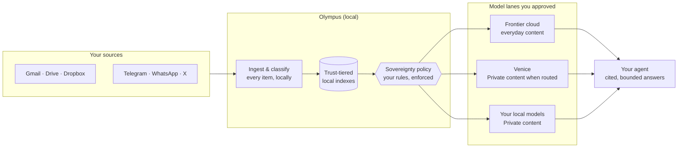
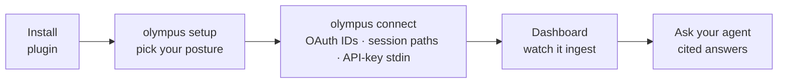

<div align="center">


# ⛰️ Olympus

**Your machine, your memory. Keep your private things private.**

*A private second brain on your own computer, for ChatGPT, Claude, Grok and any AI app that speaks MCP. On a Mac, and on [Omarchy](https://omarchy.org) Linux. Free and open source.*

[](CHANGELOG.md)
[](LICENSE)
[](CONTRIBUTING.md)
[](https://openclaw.ai)
[](https://bun.sh)

[olympusplugin.ai](https://olympusplugin.ai) · [Get started](#get-started) · [Olympus in ChatGPT](#olympus-for-chatgpt) · [Claude, Grok and other apps](#claude-grok-and-other-apps) · [How it works](#how-it-works) ·
[Sources](#supported-sources) · [Security model](#the-security-model) · [OpenClaw quickstart](docs/QUICKSTART.md) ·
[Commands](#command-reference)

</div>

---

> **🤖 Installing this as an AI agent for OpenClaw?** Stop and read
> **[INSTALL_FOR_AGENTS.md](INSTALL_FOR_AGENTS.md)** before running any
> command — it is the step-by-step runbook you must follow, including
> exactly what to tell your operator after each step (your install report
> must end with the Step 1→2 invitation, never a bare status line). Managed
> `git:`, `clawhub:`, and `npm-pack:` installs intentionally hide their internal
> package path; use the installed `olympus` CLI and this packaged runbook rather
> than searching OpenClaw's managed storage. **Setting up Olympus for ChatGPT,
> Claude or Grok instead?** Follow [Get started](#get-started), not this
> runbook.

---

Frontier AI models are the smartest, but using them means sending your life to
someone else's cloud. Local models keep it home, but they are a step behind,
and the best ones need an expensive computer under your desk. Olympus gives
you both, on the laptop you already have.

Every email, file and message is judged, one by one, as **Personal**,
**Private** or **Secret**: on your own computer by default, or by Venice's
private models if you choose a Venice-only setup.

- **Personal:** ChatGPT, Claude or Grok can read the parts that answer your
  question, and cite them.
- **Private:** only a model on your computer reads it (or Venice, if you turn
  it on); your AI app never gets the item itself. In ChatGPT, only you see the
  answer; other apps get an answer written from it, which can repeat what it
  says.
- **Secret:** passwords, recovery codes and keys. Once Olympus recognizes a
  Secret, it is never sent or answered from.

Labels are automatic and can be wrong.

Everything is stored and searched on your computer: the search index is built
there, by a model small enough for a computer with 8 GB of memory. There is no
hosted copy of your things, no account and no subscription. Olympus's
publisher runs only a relay that passes your AI app's requests to your
computer without storing them. Google sign-in happens on your computer,
directly with Google. For hard private
questions you can reach stronger models: [Venice](https://venice.ai) runs
private models that, under Venice's own terms, keep nothing you send, and
zkAPI, from OpenAnonymity and the Ethereum Foundation, hides who is asking
(see [Stronger models, privately](#stronger-models-privately)).

```text
you › "What did I commit to this week, across email and Telegram?"

agent › Three commitments: the tax documents to Maria by Friday
        (email, Tue), reviewing the lease amendment (email, Mon),
        and the Saturday ride logistics (Telegram, Wed). [3 citations]
```

Your agent saw a bounded, cited, policy-gated answer. It never saw your
mailbox.

## Get started

You need a Mac with Apple silicon (M1 or later) on macOS 13 Ventura or later,
or an x86_64 computer running [Omarchy](https://omarchy.org). Intel Macs,
other Linux distributions and ARM Linux are not supported yet. You do not need
OpenClaw, Tailscale, an API key or a new account.

**1. Install Olympus on your computer.** On a Mac, open **Terminal** and run:

```bash
curl -fsSL https://olympusplugin.ai/install.sh | sh
```

On Omarchy, first install the tools Olympus uses to read scans, photos and
voice notes, then run the Linux installer:

```bash
sudo pacman -S --needed tesseract tesseract-data-eng poppler libvips libheif ffmpeg
curl -fsSL https://olympusplugin.ai/install-linux.sh | sh
```

Either installs Olympus for your user only (the installer itself needs no
administrator password; on Omarchy, the `pacman` line above does),
checks every download against a pinned SHA-256 before using it, keeps Olympus
running in the background (a LaunchAgent on a Mac, a systemd user service on
Omarchy), adds the `olympus` command, and waits until the engine proves it is
running. On Omarchy it also adds **Olympus** to the app launcher. Then Olympus
downloads its built-in models once. Running it again updates or repairs the
install; a failed update puts the previous version back. Details, folders and
uninstall: <https://olympusplugin.ai/install/>.

**2. Connect your AI.** Each app has a short guide:
[ChatGPT](https://olympusplugin.ai/install/chatgpt/) ·
[Claude](https://olympusplugin.ai/install/claude/) ·
[Grok and Grok Bot](https://olympusplugin.ai/install/grok/) ·
[Dots](https://olympusplugin.ai/install/dots/) ·
[Claude Code](https://olympusplugin.ai/install/claude-code/) ·
[Codex](https://olympusplugin.ai/install/codex/) ·
[OpenClaw](https://olympusplugin.ai/install/openclaw/) ·
[Hermes](https://olympusplugin.ai/install/hermes/) ·
[any MCP app](https://olympusplugin.ai/install/other/). In ChatGPT, Claude
and Grok you add Olympus's address as a connector (in ChatGPT, in Developer
mode until Olympus is listed in its directory), then approve it with one
click on a page Olympus opens on your own computer: there is no pairing code
and no account to create. Grok Bot then uses the Grok connection. Apps on your
computer, such as Claude Code, Codex and Hermes, connect with one command.

**3. Connect your sources and ask.** Open the dashboard (in ChatGPT, ask
*"Show my Olympus dashboard"*; on your computer, run `olympus dashboard`),
connect Dropbox, Gmail or Google Drive, pick folders, and ask the way you
normally would.

## Olympus for ChatGPT

In ChatGPT, Olympus is a plugin. The Olympus engine runs on your computer and
keeps your index there; ChatGPT asks it questions through one secure
connection that you approve on that computer.

### 1. Add Olympus in ChatGPT

Install Olympus on your computer first ([Get started](#get-started)).
Olympus is on its way to ChatGPT's app directory. Until it is listed, add it
yourself: in ChatGPT, open **Plugins**, choose **+**, then **Add custom MCP
server**. Name it Olympus, choose OAuth, and paste
`https://mcp.olympusplugin.ai/mcp` as the URL. If you don't see Add custom MCP
server, turn on **Developer mode** in **Settings** first. OpenAI decides
which accounts have Developer mode; in a work or school workspace, an admin
may need to allow it. Step by step:
<https://olympusplugin.ai/install/chatgpt/>. On Omarchy,
ChatGPT may still say Olympus needs a Mac; it works on Omarchy too.

### 2. Approve ChatGPT on your computer

The first time ChatGPT connects to Olympus, an Olympus page opens in your
computer's browser asking *Connect ChatGPT to Olympus?* Click **Connect**. (If a
page saying *Approve ChatGPT on your Mac* comes first, click **Continue on
this Mac**; the page says Mac on Omarchy too.) Clicking Connect on your own
computer is how Olympus knows the computer is yours: there is no code to copy and no account to create. To check on it later, run `olympus engine status` in a terminal.

### 3. Connect Dropbox and choose folders

Open the **Olympus** dashboard in ChatGPT's sidebar (or ask *"Show my
Olympus dashboard"*). Choose **Connect** next to Dropbox and sign in with
your own Dropbox account; the sign-in link works once, for 10 minutes, from
any device. Gmail and Google Drive connect the same way, except that you open their
sign-in link on the computer where Olympus runs, not on a phone.

Then pick folders. For each folder choose:

- **Full**: Olympus reads the files and can answer from what they say.
- **Names only**: Olympus keeps the file names and details such as dates,
  not what the files say.
- **Skip**: Olympus leaves the folder alone.

A folder follows its parent's choice unless you change it; **Mixed** means
some folders inside it are set differently. Choose **Save and start**, and
indexing begins on your computer.

### 4. Tell Olympus what's private

Olympus sorts every item, one by one, into one of three tiers:

- **Personal**: everyday mail, notes and files. ChatGPT can see the parts
  that answer your question, and cites them.
- **Private**: things you keep to yourself, such as health, money or family
  matters. What they say is never sent to ChatGPT. Olympus answers from
  them on your computer, in the private answer panel (below).
- **Secret**: passwords, recovery codes and keys. What Olympus recognizes as a
  Secret never reaches a model and is never answered from.
  Recognition looks for common forms (private keys, API keys, labeled
  passwords) and can miss others.

Olympus decides on your computer. Once its built-in private model is ready, it
checks every item it reads before treating it as Personal. Labels are
automatic and can be wrong. In the dashboard,
**Privacy** asks *"What's private for you?"*: answer in your own words. You
can also mark folders, Gmail labels or senders as always Private.

### 5. Ask

Ask in ChatGPT the way you normally would: *"What did Sam say about the
lease?"* ChatGPT searches Olympus and answers from your Personal items, with
citations.

### The private answer panel

When some of the items that match your question are Private, a small Olympus
panel appears on its own under ChatGPT's reply: **Private answer from your
computer**, marked **Not sent to ChatGPT**.

- Your computer writes the answer with its built-in private model (Qwen3.5,
  sized to its memory: 2B under 16 GB, 4B with more) and sends it to the panel sealed, so only the panel can open it. It goes
  around the ChatGPT conversation, not through it, and the Olympus relay
  cannot read it.
- On an Apple silicon Mac it usually arrives within a minute; on Omarchy it
  depends on the computer's processor and can take a few minutes. Ask for *"all the details"* and
  Olympus reads the whole documents instead; that can take a few minutes.
- **Sources** (closed at first) lists the items the answer used. Click one to
  open it on your computer, or in Dropbox on the web if it is not on this computer
  (ChatGPT opens that web link for you, so it sees the address).
- **Hide** folds the answer away and **Show** brings it back. An answer
  expires after 10 minutes; ask again for a new one.
- Ask follow-up questions in the chat as usual; each private answer appears
  in a new panel.

Your computer needs to be awake and online. The panel runs inside ChatGPT's page,
so it relies on the panel code ChatGPT loads; the
[design](docs/design/chatgpt-plugin.md#who-can-read-the-answer) states that
limit plainly.

### What ChatGPT can and can't see

ChatGPT **can** see:

- The parts of your Personal items that answer a question: excerpts, titles,
  dates and links.
- File names, including the names of some Private items. A file's name can be
  Personal while what it says is Private, so its name may show up in ChatGPT;
  its contents never do.
- That some items matching a question are Private: ChatGPT's model learns
  just that, with no titles and no content.
- Status: which sources are connected, how far indexing has got, and what
  needs you. The folder picker shows your folder names inside ChatGPT so you
  can choose; they pass through ChatGPT to reach the picker, but ChatGPT's
  model is not given them.

ChatGPT **can't** see:

- What your Private items say, or the private answers made from them.
- Secret items Olympus recognizes.
- Folders you skip, or what the files in Names-only folders say.
- API keys or passwords: you never enter one in ChatGPT. Optional extras such
  as a Venice account are set up on your computer.

The relay at `mcp.olympusplugin.ai` passes ChatGPT's requests to your computer. It
stores and logs no questions, answers or tokens, but like any HTTPS service
it handles them in transit. Full details: the
[ChatGPT design](docs/design/chatgpt-plugin.md) and the
[trust model](docs/TRUST_MODEL.md).

## Claude, Grok and other apps

Claude (web, desktop and phone) and Grok connect through the same Olympus
relay as ChatGPT, with one click to approve on your computer, and Grok Bot
uses the Grok connection; apps
on your computer, such as Claude Code, Codex and Hermes, connect there
directly. Guides: <https://olympusplugin.ai/install/>.

They search what is Personal, with citations, like ChatGPT. They never get
your Private items themselves or the Secrets Olympus recognizes. For Private
items they get at most an answer that the private model on your computer (or
Venice, if you set it up) writes from them, checked for secrets, with each
item's title, path, source and author. That answer can repeat what the items
say. ChatGPT is stricter: it gets no answer from Private items
at all, and shows one only in its private answer panel. When an agent is not
given an answer, Olympus records the question and the model built into
Olympus answers it on your computer; the agent is told only that the answer is
in Olympus on your computer, with a link (`olympus://open/private/` and a
random identifier) that opens it there. The answer waits in the dashboard's
[Inbox](https://olympusplugin.ai/open/private/) (under **On this computer**),
which Olympus gives no AI app a way to read, until you delete it or the Inbox
removes the oldest answers when full, and **Needs you** counts the
answers you have not read. More: [Connect other
agents](#connect-other-agents).

## Stronger models, privately

For hard private questions you can reach stronger models without giving
yourself away. Both are off until you turn them on.

- **[Venice](https://venice.ai)** runs private models that, under Venice's own
  terms, keep nothing you send. Add your Venice key under **Keys**, on your
  computer. In **Ask a question**, a Venice model reads the passages of your
  files it needs, and is available only if your privacy settings allow Private
  items to go to Venice; a key alone does not allow it.
- **zkAPI**, from OpenAnonymity and the Ethereum Foundation, hides who is
  asking. It pays anonymously and sends the question over Tor (on unless you
  turn it off; without Tor, your network address shows): no account, no card,
  no name, just proof the question is paid for. In **Strict** mode your
  computer first rewrites the question into general questions; **Standard**,
  by default, takes out names, contact details and account numbers, or sends
  your words as written if you choose that. What you ask can still identify
  you. Turn on **Anonymous answers** under **Keys** on your computer, then
  ask from your agent or from **Ask a question** in the dashboard's
  [Inbox](https://olympusplugin.ai/open/private/); each question as sent, and
  its reply, stay in the Inbox on your computer until you delete them or the
  Inbox removes the oldest when full.
  Anonymous answers work on a Mac and on Omarchy (x64, Linux 6.7 or newer),
  once Olympus's network isolation checks pass.

## Uninstall

On a Mac, run `curl -fsSL https://olympusplugin.ai/uninstall.sh | sh`; on
Omarchy, `curl -fsSL https://olympusplugin.ai/uninstall-linux.sh | sh`. Both
stop Olympus and remove the app, the runtime and the `olympus` command, and
keep your settings and data. To delete those too, first run
`olympus engine stop` and `olympus data delete --all`. To only stop Olympus
and remove its login item or service, run `olympus engine uninstall`.

The rest of this README covers how Olympus works and Olympus with OpenClaw,
which stays supported and optional.

## How it works

Olympus ingests your sources into local, trust-tiered indexes, then lets your
frontier agent answer questions across all of them, with sensitive material
handled only by lanes you approved: your own local models,
privacy-approved private cloud inference, or not at all.

Every item you ingest is judged on its own as Personal, Private, or Secrets
(plus Public on installs made before 1.0; internally S0-S5): its names are Personal unless something raises
them, and its content is raised to Private or Secrets on evidence. Each tier
has its own index and routes only to the model lanes your sovereignty policy
allows:



Olympus uses **Personal** (ordinary personal and work content), **Private**
(sensitive material), and **Secrets** (once recognized, never model input). There is no
Public tier on any new install, ChatGPT or OpenClaw, whichever posture you
choose: anything that would have been Public is Personal. Installs made
before 1.0 keep a **Public** tier. See the
[tier mapping](docs/TRUST_MODEL.md#product-tier-names) for the unchanged
storage identifiers.

Four postures, chosen (and changeable) in setup — a config file, not a code
fork:

| Preset | Personal content | Private content: health, finance, legal, therapy, family |
|---|---|---|
| **Local models and private cloud** (`local-first`) | frontier cloud | approved secure pool with explicit local → [Venice](https://venice.ai) Private order |
| **Local models only** (`local-only`) | frontier cloud | your own local models only |
| **Private cloud only** (`private-cloud-only`) | frontier cloud | [Venice](https://venice.ai) Private model (`kimi-k3`) |
| **Private meaning search on this computer** (`no-sensitive`) | frontier cloud | **stored and searched by meaning on this computer**: its search vectors come from the built-in model and are kept here; no Private agent answer lane |

“Private cloud only” describes **Private-data handling**: Venice answers
Private questions. Search indexing for every tier uses EmbeddingGemma 2,
Google's small embedding model, built into Olympus: it downloads once, runs on
your computer, needs no account or key, and sends nothing anywhere. On a Mac it
also reads pictures, so photos are searchable by what is in them. Gemini, local, or Venice Private embeddings
stay an opt-in choice, and Private content never goes to Gemini. Personal
questions use OpenClaw's own configured default model.

One question searches every tier. When it finds Private evidence, the private
lane your posture approved answers it and your agent receives only the checked,
cited answer. Secrets Olympus recognizes are never searched by content: it can tell you where
one lives, never what it says.

Some rules are not configurable, by design: secure content never routes to
ordinary cloud models, recognized secrets are denied to every lane, and an
exhausted policy chain refuses rather than silently downgrading.

## Get started with OpenClaw

Using ChatGPT? See [Olympus for ChatGPT](#olympus-for-chatgpt) instead; none
of this section is needed.

**You need** OpenClaw `2026.7.1+` on a Node release OpenClaw itself supports
(`>=24.16.0 <25` or `>=26.1.0` for OpenClaw 2026.9.5; check
`npm view openclaw engines` — its installer refuses any other), plus
[Bun](https://bun.sh) `1.2+`. macOS or Linux.

Paste this into OpenClaw, or another agent with a terminal:

> Install Olympus by reading https://raw.githubusercontent.com/jamiezigelbaum/Olympus/main/INSTALL_FOR_AGENTS.md and following it step by step. Walk me through setup and ask me about my data and privacy preferences.

Your agent downloads the designated pilot package, checks it automatically,
and guides you through setup. You do not need to download files, find a
checksum receipt, or have a GitHub account. The agent checks the SHA-256 and
byte count against the designated candidate and GitHub's release metadata.

`openclaw plugins install clawhub:olympus` becomes the one-line public path
once Olympus is published to ClawHub, which happens **after** the pilot. The
pilot and release qualification both use the managed `npm-pack:` path — see
[docs/V0_4_RELEASE.md](docs/V0_4_RELEASE.md). A Git checkout or rebuilt package
does not qualify the supplied candidate.

`--accept-capabilities` is required by OpenClaw `2026.8.1+`: an agent-driven
install is non-TTY, and without the flag the host exits 1 asking for capability
consent it cannot prompt for. Omit the flag on `2026.7.1`, which does not
define it.

The agent checks prerequisites, installs the plugin, talks through what is
private for you (you save it later in the dashboard's Privacy section), asks
for your privacy posture and your approval of the private classifier,
verifies the worker, restarts the gateway, and hands you the dashboard. You paste your model keys into its **Models** section
yourself; the agent never collects them. That completes base installation.
Then you can choose a source in the dashboard or leave Olympus ready for
later; no source is selected for you. Once your chosen source is ready, the
agent checks a first answer and its citations.

Prefer to drive it yourself? Follow **[docs/QUICKSTART.md](docs/QUICKSTART.md)**,
starting with the automatic download and existing-install checks. Its install
command for a clean machine is:

```bash
openclaw plugins install npm-pack:/absolute/path/to/olympus-1.1.0.tgz --force --accept-capabilities
# On OpenClaw 2026.7.1, omit both flags for a clean install.
# On newer hosts, --force also overwrites an existing plugin: check first.
openclaw plugins enable olympus
OLYMPUS_ROOT="$(openclaw plugins inspect olympus --json | jq -r .plugin.rootDir)"
OLYMPUS_BIN="$OLYMPUS_ROOT/bin/olympus"
"$OLYMPUS_BIN" doctor
```

Continue the quickstart to describe your data, choose a privacy posture,
connect model credentials, and verify base activation before choosing your
sources in the dashboard and checking the first cited answer. The CLI lives inside the
managed plugin; use the resolved executable rather than assuming it is on PATH.

This candidate artifact includes native Control UI support. On OpenClaw
**2026.9.2**, use **Olympus** in the Control UI sidebar to connect
sources, choose scope, and follow ingestion. Enable **Settings → Labs → Custom
plugin UI** (the Gateway restarts itself to apply it on OpenClaw 2026.9.5; run
no second restart), then reload the browser. OpenClaw currently makes this integration experimental
and requires its own Gateway's Control UI over HTTPS or localhost. Olympus uses
your signed-in OpenClaw permissions; its worker token stays on the server.
The standalone `olympus dashboard` command remains available for older hosts,
when custom plugin UI is off, and for direct access when needed. See the
[dashboard guide](docs/QUICKSTART.md#5-open-your-dashboard-and-connect-sources).

For Gemini embeddings, Venice accounts/API credit, or local models, use the
[agent-led model setup guide](docs/SOVEREIGNTY_CONFIG.md#agent-led-model-setup-for-the-v04-beta).
It explains the separate Private and Personal routes, registered embedding
defaults, and custom-model requirements before you connect keys or restart.
In the dashboard you paste each key into its **Models** card. For a headless
setup, choose how to supply each key: paste it yourself from your password
manager's website into the silent terminal input, or authorize an
exact named-item read through an already authenticated manager CLI. The manual
route needs no password-manager desktop app or CLI; a 1Password `op://`
reference needs authenticated `op` access for an agent fetch.

On OpenClaw `2026.9.2`, use Olympus in the Control UI sidebar when the installed
Olympus artifact includes native Control UI support and Custom plugin UI is
enabled. Host version alone is not proof of support. Otherwise the quickstart
uses the retained standalone dashboard; it explains the different authentication
requirements for each route.

## Supported sources

| Source | Connect flow | Notes |
|---|---|---|
| Gmail | browser OAuth | one account |
| Google Drive | browser OAuth | docs + files |
| Dropbox | browser OAuth | full file spine: metadata, extraction, OCR, audio transcribed on your machine |
| Telegram | guided phone login | forward sync of active chats |
| WhatsApp | QR pairing | live bridge |
| X bookmarks | browser OAuth with a user-owned developer app | folder provenance and provider cost ceilings |
| Readwise | API key | optional |

Model-lane credentials such as Venice are security-preset prerequisites, not
source connectors. Domain-agent imports and other source families are outside
the 1.0 public roster.

Tokens live in an encrypted local secret store by default, or in an explicitly
configured OS secret store when supported, never in plain text.
Ingestion, classification, and indexing all run in one supervised local
worker — `olympus worker install` makes it start on login. All seven declared
sources sync through the canonical connector-store runtime; Olympus supports one
connected account per provider. After base activation, dashboard onboarding
guides the source you choose from credentials and scope through initial sync
and cited-answer readiness, with the next supported action on blocked or
degraded sources. The seven-source roster is not an installation checklist.
Clean-install and real-provider qualification remain Slice 4 work, not alternate ingestion
paths.

On an existing live OpenClaw install, treat plugin install/enable, gateway
restart, worker service changes, and plugin refresh as live-system changes:
validate with `openclaw config validate` and `openclaw doctor --lint`, then
restart only through `openclaw gateway restart` or the documented ops refresh
script. The repo docs and commands should never require raw edits to
OpenClaw runtime config.

## The security model

Olympus is built on the assumption that the boundary *is* the product:

- **Local-first ingestion.** Raw source content lands in local SQLite
  indexes before any model sees anything. Classification happens on your
  computer unless you choose Venice for it.
- **Sanitized handoffs.** Agents receive answer text, excerpts of Personal
  items, citations, and audit counts — typed wire shapes with
  `raw_source_exposed: false`, re-validated client-side. Embeddings, cursors,
  and tokens never cross. Private items reach an agent only as answers
  written from them, which can repeat what they say; ChatGPT's model gets none.
- **A hard membrane.** Any evidence pack containing sensitive material is
  barred from standard cloud lanes by two independent checks — policy
  validation at config load, and a runtime re-check on every request.
- **Fail closed, everywhere.** No approved lane for a tier means a refusal
  with an honest error — never a silent fallback to a less-trusted model.
- **Authenticated by default.** The worker binds loopback with bearer-token
  auth on every route; new installs generate the token during setup. Browser
  controls exchange it for a short-lived HttpOnly local session protected by
  same-origin and CSRF checks; the bearer is never stored by the page.
- **A real exit.** `olympus data export` gives you your data;
  `olympus data delete --all` verifiably removes indexes, embeddings,
  configs, tokens, and service units.

The onboarding flow, end to end:



## Command reference

| Command | What it does |
|---|---|
| `olympus setup --preset <preset> --yes` | writes sovereignty policy and worker auth for the chosen posture |
| `olympus connect <source> ...` | records OAuth, session, or API-key credentials with source-specific flags |
| `olympus worker foreground\|install\|start\|stop\|restart\|status\|upgrade\|uninstall` | one versioned lifecycle for the local engine, foreground or supervised |
| `olympus dashboard` | opens the standalone dashboard with a short-lived authorization link; no worker-token copying |
| `olympus dashboard --no-open` | generates an unused opening link for an agent to hand to you |
| `olympus dashboard token` | advanced compatibility access to the worker bearer; never share it in chat |
| `olympus source answer "…"` | ask across your sources from the terminal |
| `olympus ask "…" [--level strict\|standard]` | one question to a frontier model anonymously through zkAPI (paid from your zkAPI balance; the question only) |
| `olympus archive start --path <path>\|status\|remove --archive-id <id>` | asks to import an old export (such as a mail `.mbox`) or to remove an imported one; you approve on the dashboard, and `status` shows progress without any message text |
| `olympus tier explain\|set\|rules\|classifier …` | why an item has its tier, owner overrides and rules, and the private classifier's approval |
| `olympus tier migrate plan\|approve\|run\|rollback\|purge\|status` | moves an existing install's items into per-item tiers, each step owner-approved after a dry-run plan |
| `olympus doctor` | diagnoses problems, each with a fix-it hint |
| `olympus data export\|delete` | your data, out — or gone |
| `olympus serve` | MCP stdio server for non-OpenClaw agents |

`olympus worker install` and `upgrade` atomically reconcile the generated
service unit and owner-only worker environment before activation. Interrupted
install or upgrade transactions recover the previous managed files when the
same command is rerun. `status` reports the observed service and transaction
state; it never guesses that an unreadable manager or non-regular managed path
is healthy. `uninstall` removes only the supervised service and intentionally
retains credentials, source configuration, and indexed data. Use the separate
data lifecycle when those bytes should also be removed.

Credential, scope, pairing, Disconnect, partial-sync, and source-dependency
repairs do not normally require a worker restart. Follow the source card or
`olympus doctor` recovery action instead.

Dashboard **Disconnect** stops new scheduled and manual reads, removes the
selected local account grant, and keeps indexed data and reusable developer-app
registration. It does not revoke provider-side access; the card links the
provider revocation page. Local data deletion remains the deliberate CLI-only
flow: preview `olympus data delete --source <id> --dry-run`, Disconnect the
source, then run the command without `--dry-run`.

Telegram and WhatsApp are paired sessions rather than broker grants, so their
cards carry **Unpair** instead: it stops new reads and deletes this computer's
pairing session, keeping indexed messages and captured media, and leaves the
linked device in place at the provider for you to remove there.

### Connect other agents

Open the dashboard on this computer (`olympus dashboard`). Under **On this
computer**, choose **Open** next to **Agents**, then press **Connect an
agent**. Pick the agent you use and follow its steps; every address and
snippet has a copy button.

- **ChatGPT**: add Olympus in ChatGPT (Developer mode until it is listed;
  see [Olympus for ChatGPT](#olympus-for-chatgpt)), then click **Connect** on the
  page that opens in this computer's browser.
- **Claude Code** and **Codex** on this computer: copy the prompt (or the
  `olympus serve` command) into the agent. This works without remote access.
- **Claude** (web, desktop and phone) and **Grok** (grok.com): add Olympus
  as a connector with the address the panel shows, then click **Connect** on
  the page that opens in this computer's browser.
- **Grok Bot**: nothing to add. Once Olympus is connected on grok.com,
  Grok Bot uses that connection, with the same xAI account.
- The **Grok API** and other agents in the cloud need a tunnel you run
  yourself (below); the panel says so until remote access runs through one.

Agents in the cloud reach Olympus only when remote access is on; the Agents
page says whether it is. To turn it on, press **Turn on remote access**
there. Olympus then connects through the Olympus relay
(`mcp.olympusplugin.ai`): you create no account and run no tunnel. The relay
passes requests between your agents and this computer; it stores and logs no
questions, answers or tokens, but like any HTTPS endpoint it handles them in
transit. The relay connects ChatGPT, Claude, Grok (grok.com) and Grok Bot,
and approving one happens on this computer only, with one click on a page
Olympus serves locally; there is no pairing code. A Claude connector
approved on this computer then works in Claude on your phone too.
**Turn off remote access** turns it off again. If the
relay cannot be reached, the page says **Olympus relay unavailable** and
Olympus keeps retrying on its own; agents on this computer are unaffected.

Advanced: to use a tunnel you run yourself instead of the relay, set
`plugins.entries.olympus.config.remote.publicBaseUrl` to its https origin
(`openclaw config set …`) and turn remote access on. Through your own tunnel,
Claude, ChatGPT and Grok approve Olympus on its approval page with a one-time
pairing code from the Agents page, and the Grok API takes an address plus a
key from **Create key** (shown once).

Every connected agent gets the same privacy rules
as your OpenClaw agent. It never gets Private items themselves or the Secrets
Olympus recognizes. For Private items it receives only answers that Venice or
a local model wrote from them, which can repeat what they say, with each
item's title, path, source and author. The Agents page
lists connected agents with when each was added and last used, and
**Revoke** removes one. `olympus connections list|revoke|pair|add` does the
same from a terminal.

Each agent's steps end with a short instruction that tells it when to ask
Olympus. Paste it into Claude project instructions, Grok's custom
instructions or Grok Bot's skills, or
load the packaged Agent Skills folder
[`integrations/agent-skills/ask-olympus/`](integrations/agent-skills/ask-olympus/SKILL.md).

### Using Olympus from other agents (MCP)

`olympus serve` exposes the same sanitized read operations — `source_answer`,
`source_answer_result`, `source_index_status`, capability-gated
`source_index_search`, `ask_anonymously`, and `archive_import` — to any MCP-capable agent. The
supported Hermes configuration narrows that server to exactly `source_answer`,
`source_answer_result`, `source_index_status` and `ask_anonymously` through its
per-server tool allowlist.

`archive_import` (start, status, remove) lets an agent ask to import an old
export the user wants searched, such as a mail `.mbox` from Google Takeout or
Apple Mail. It only asks: `start` stores the path as text without opening it
and returns `needs_approval`; the user approves on the Olympus dashboard on
their computer (Sources, Archives), and `remove` works the same way. `status`
reports each archive's progress, counts, date range and gaps, never message
text. It is on the native, MCP and CLI surfaces only, not on Hermes, remote MCP
or the ChatGPT relay.

`ask_anonymously` sends one typed question to a frontier model through zkAPI
(paid per question, anonymously, from the user's own balance; what the
question says can still identify them). The
first call with no `level` returns `needs_choice`: the agent asks the user once
for Strict (their own model rewrites the question into general questions before
it leaves) or Standard (their words, prepared as written, lightly cleaned up or
by their saved instruction), then calls again with `level` and `remember: true`.
Only the question goes out, never documents, and never to the provider that
hosts the agent asking: a question from ChatGPT goes to Claude Sonnet by
default, one from Claude Code or Claude Desktop to an OpenAI model, and a
one-off `model` from the agent's own provider is refused. Setup (the zkAPI
route, the writer model, the zkAPI models for questions from ChatGPT and from
Claude, the spend limit) lives on the dashboard's Anonymous answers card, under
Keys. Questions are asked through an agent, `olympus ask`, or **Ask a
question** in the dashboard's Inbox; each question as sent, and its reply, are
kept in the Inbox on your computer until you delete them or the Inbox removes
the oldest when full. See
[`docs/design/private-answers.md`](docs/design/private-answers.md).

MCP clients cap how long one tool call may run, and an answer can take several
minutes. So over MCP (local `olympus serve` and remote `/mcp` alike) and the
OpenAPI tool paths, a `source_answer` that is not done by a hand-off threshold
returns `{"status": "working", "job_id": …}` and keeps running. The threshold
is 200 seconds for remote agents (`OLYMPUS_SOURCE_ANSWER_HANDOFF_MS`) and 45
seconds for local `olympus serve` (`OLYMPUS_SOURCE_ANSWER_STDIO_HANDOFF_MS`,
under Codex's 60-second default tool timeout); both are capped at 230000.
`source_answer_result` with that `job_id` returns the answer, the same error
the call would have raised, or `working` again after waiting up to a minute
(never longer than the threshold). A slow `ask_anonymously` (a Tor route can
take minutes) hands off the same way and is collected with the same tool. A job that runs past 20 minutes is stopped
with `source_answer_deadline`, and revoking a connection drops its jobs.

Remote answers share the analyst with your own assistant's answers; there is
no priority lane. So the worker runs at most two remote answers at once (the
analyst's lane count; `OLYMPUS_SOURCE_ANSWER_MAX_RUNNING` raises it for a
multi-lane analyst) and refuses more with `source_answer_busy`, which bounds
how much remote work can ever queue ahead of your own question. A caller that
disconnects, or a job that reaches its deadline, stops the analyst call
itself and frees the lane. A job id is readable
only by the connection (or `olympus serve` process) that asked, lives in
memory, and expires 15 minutes after its answer is ready.

For Hermes Agent, resolve the installed plugin first:

```bash
openclaw plugins inspect olympus --json
```

Copy `plugin.rootDir` from that content-free response, append `/bin/olympus`,
and pass the resulting absolute executable path to Hermes:

```bash
hermes mcp add olympus --command /absolute/managed/olympus/bin/olympus --args serve
hermes mcp test olympus
```

Make the `olympus` server entry in `~/.hermes/config.yaml` match the packaged
[`config/hermes/olympus.mcp.yaml`](config/hermes/olympus.mcp.yaml):

```yaml
mcp_servers:
  olympus:
    command: <absolute-managed-plugin-root>/bin/olympus
    args: [serve]
    tools:
      include: [source_answer, source_answer_result, source_index_status, ask_anonymously]
      prompts: false
      resources: false
```

Restart Hermes or run `/reload-mcp`, then verify that the discovered registered
names are exactly `mcp_olympus_source_answer`,
`mcp_olympus_source_answer_result`, `mcp_olympus_source_index_status` and
`mcp_olympus_ask_anonymously`. Invoke the discovered names rather than
hard-coding them. A cited-answer round trip uses the discovered
`mcp_olympus_source_answer`; `source_watch_*` remains OpenClaw-only.

The optional packaged Hermes skill is
[`integrations/hermes/ask-sources/SKILL.md`](integrations/hermes/ask-sources/SKILL.md).
Copy its directory to `~/.hermes/skills/ask-sources/` or expose the parent with
`skills.external_dirs`; it declares the same four tools and no fallback access.

No `hermes://mcp/install` link is published: current Hermes upstream documents
custom MCP installation through `hermes mcp add` but does not document that URI
handler. No Nous catalog submission has been made; that remains a later,
separately reviewed external action.

There are no operator agent tools. Index maintenance — sync, extraction,
embedding, retries — is the worker's own scheduler, and what a person drives by
hand goes through the `olympus` CLI. The whole agent tool surface is thirteen tools —
`argus_ping`, `argus_list_models`, `argus_complete`, `source_answer`,
`source_answer_result` (MCP and remote only), `source_index_status`, `source_index_search`, `source_watch_create`,
`source_watches`, `source_watch_cancel`, `olympus_doctor`, `ask_anonymously`, `archive_import` — declared in
[`src/core/public-surface.ts`](src/core/public-surface.ts); Hermes over MCP sees
the subset above, and worker bearer auth is enforced throughout.

Operational note for connector-store corpora: run the matching sync script
first, then mount the same SQLite store in the source worker with
`OLYMPUS_SOURCE_INDEX_CONNECTOR_STORES_JSON`. The worker env entry must use
the same corpus id, `family`, `trustDomain`, and `dbPath` the sync script
writes, and that corpus id must be in the corpus registry — a store mounted
for an unregistered corpus fills but is never read.

Chat-family mounts must also declare their exact principal identity with
`principalProvider` and `principalAccountScope` (for example, `whatsapp` and
`personal`). Structured scopes use the stored account scope as their prefix, so
the shipped WhatsApp identity is `personal:chat:<id>` while Telegram remains
`telegram.personal:chat:<id>`. A chat mount without both fields remains
available for non-`chat_scope` reads, but `chat_scope` filtering fails closed
as not configured; mounted rows never establish account authority.

The migration-era indexes, replay/import utilities, read-authority switches,
and retired store writers were removed in Slice 2. Canonical connector stores
are now the only source read/write authority. Compatibility aliases that
remain at input boundaries do not select another runtime or store.

## Development

Olympus is TypeScript on Bun: one plugin package, stable versioned architecture
contracts (`SourceConnector` / `EvidencePack` / `Analyst` — only the
connector is per-source), and 3,400+ tests including an architecture guard
that keeps per-source answer logic out of the shared spine.

```bash
bun install
bun run test:focus -- test/example.test.ts
```

Use focused local proof while editing; GitHub requires each substantive CI lane
and runs the complete suite in parallel before merge. See the canonical
[engineering process](docs/ENGINEERING_PROCESS.md).

Deep-dive docs: [contracts and architecture](docs/CONTRACTS.md) ·
[trust model](docs/TRUST_MODEL.md) · [sovereignty config](docs/SOVEREIGNTY_CONFIG.md) ·
[uninstall](docs/UNINSTALL.md)

## License

[MIT](LICENSE) — free for any use, including commercial. Olympus is provided
as is, without warranty; keep your own backups. Olympus is published by Open
Coordination Unlimited, Inc. Its hosted relay is governed by the
[Terms of Service](https://olympusplugin.ai/terms/) and
[Privacy Policy](https://olympusplugin.ai/privacy/). Third-party data notices:
[docs/THIRD_PARTY_DATA.md](docs/THIRD_PARTY_DATA.md).

Want to suggest a change? See [CONTRIBUTING.md](CONTRIBUTING.md): fork,
branch, open a PR. Read access doesn't include direct pushes — everything
lands through review.
